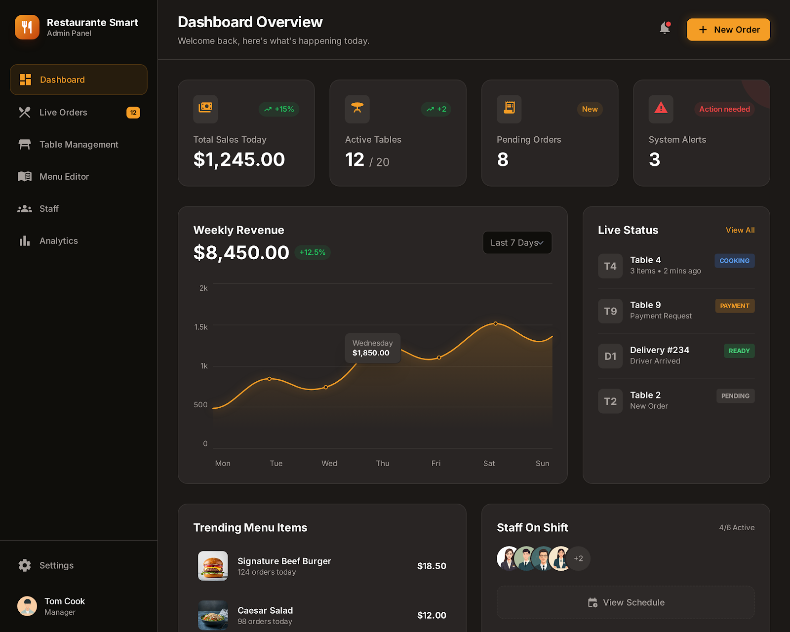
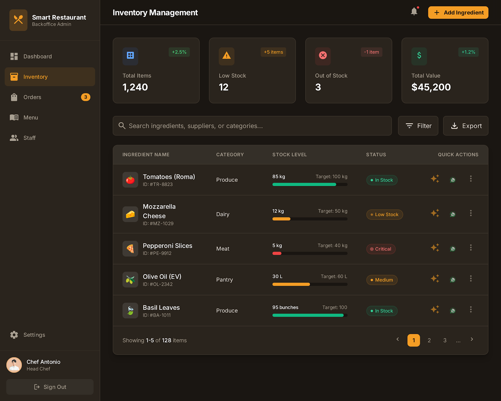

# RestauranteSmart

Aplicación web para la gestión integral de un restaurante, con asistentes de IA generativa (Gemini) para cocina e inventario. Funciona como PWA y sincroniza en tiempo real entre sala, cocina y gerencia.

**Stack:** Angular 21 · TypeScript · Firebase (Authentication, Firestore, Hosting, AI Logic, App Check) · Gemini 3.8 Flash · Tailwind CSS

<p align="center">
  
  
</p>

## Funcionalidades

| Perfil | Módulo | Qué hace |
|---|---|---|
| Cliente | **Carta digital y reservas** | Consulta la carta en tiempo real y reserva mesa sin registrarse. |
| Sala | **Mis mesas** | Abre comandas, añade platos y cobra la mesa. |
| Cocina | **Monitor de cocina** | Cola de comandas en tiempo real. La IA propone cómo agrupar los platos pendientes por estación (freidora, plancha…). |
| Personal | **Reservas** | Gestión y confirmación de las reservas recibidas. |
| Gerencia | **Inventario inteligente** | Control de stock con alertas de nivel crítico y un informe de compra generado por IA. |
| Gerencia | **Carta, personal y ventas** | Edición de platos, altas y roles de empleados, histórico de caja y ventas. |

## Seguridad

La primera versión del proyecto tenía los fallos típicos de un prototipo: claves de API en el frontend, PINs en texto plano y permisos decididos en el navegador. Esta versión los corrige así:

- **Sin secretos en el cliente.** Gemini se llama a través de **Firebase AI Logic**, que guarda la clave en el servidor. La configuración web de Firebase sí es pública por diseño, como en cualquier app de Firebase.
- **Protección anti-abuso.** **Firebase App Check** con reCAPTCHA Enterprise (Fraud Defense): AI Logic solo atiende peticiones que vienen de la web publicada, así que nadie puede gastar la cuota de Gemini desde fuera.
- **Autenticación real.** Cada empleado entra con usuario + PIN mediante **Firebase Authentication**. El PIN es la contraseña de su cuenta, así que Firebase lo guarda con hash y limita los intentos. Nunca se guarda en Firestore.
- **Autorización en el servidor.** Las [reglas de Firestore](firestore.rules) deciden qué colección puede leer o escribir cada rol (cliente, empleado, gerente) y validan las reservas que llegan de clientes anónimos. Los guards de Angular solo controlan la navegación, así que manipular el navegador no da acceso a los datos.
- **Alta de empleados sin cerrar la sesión del gerente.** Se usa una instancia secundaria de Firebase Auth con persistencia en memoria.
- **Sin fugas de memoria.** Todas las suscripciones en tiempo real (`onSnapshot`) se cancelan al destruir el componente mediante `DestroyRef`.

## Puesta en marcha

Requisitos: Node.js 20+ y un proyecto de Firebase.

```bash
npm install --legacy-peer-deps
npm start            # http://localhost:4200
```

Configuración del proyecto de Firebase:

1. **Authentication → Sign-in method:** activar *Correo electrónico/contraseña*.
2. **AI Logic:** activar el servicio con la *Gemini Developer API*.
3. **App Check:** registrar la app web con el proveedor *Fraud Defense (reCAPTCHA Enterprise)* usando la clave de sitio de `firebase.config.ts`.
4. **Reglas de Firestore:** `npx firebase-tools deploy --only firestore:rules`
5. **Primer gerente.** Las reglas impiden que alguien se asigne el rol a sí mismo, así que el primero se crea a mano:
   - En *Authentication → Añadir usuario*, crear `<usuario>@restaurante-smart-c1de7.web.app` con un PIN de 6 cifras como contraseña.
   - En *Firestore*, crear el documento `usuarios/<UID de ese usuario>` con `nombre`, `usuario` y `rol: "Gerente"`.
   - A partir de ahí, el resto del equipo se da de alta desde *Gestión de personal*.

Para desplegar:

```bash
npm run build
npx firebase-tools deploy
```

## Estructura

```
src/app/
├── services/      AuthService (sesión y roles) e IaService (Gemini vía Firebase AI Logic)
├── guards/        staffGuard y adminGuard
├── carta/         Carta pública y reservas
├── mis-mesas/     Comandas de sala
├── monitor-cocina/
├── smart-inventory/
├── admin-*/       Módulos de gerencia (carta, personal, reservas, ventas)
└── firebase.config.ts
firestore.rules    Autorización por rol
docs/prototipos/   Diseños iniciales de las pantallas
```

## Próximos pasos

- Tests unitarios de los servicios y tests de las reglas con el emulador de Firestore.

---

Proyecto académico del Grado en Ingeniería Informática (Universidad Europea de Madrid). Autor: [Samuel Jiménez López](https://github.com/samujimlop).
